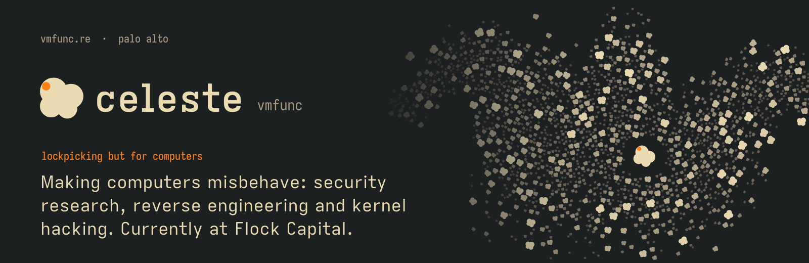
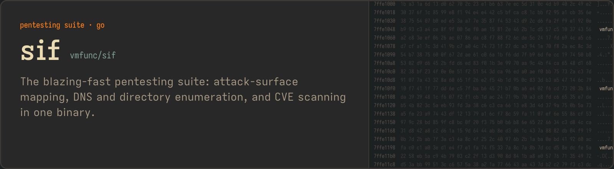
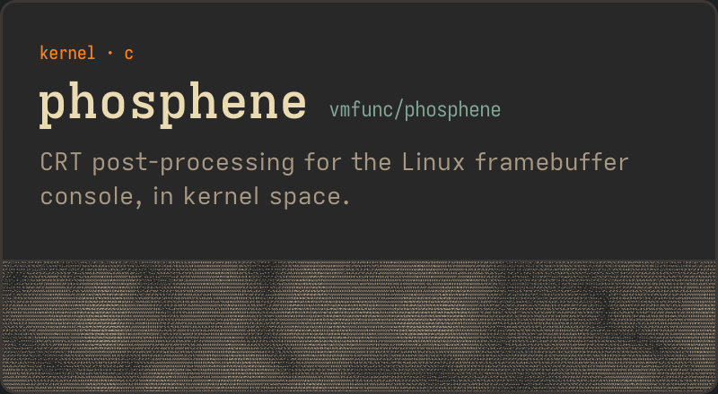
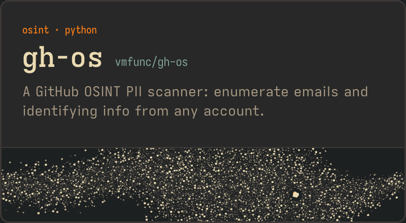

<a href="https://vmfunc.re"><picture><source media="(prefers-color-scheme: dark)" srcset="https://github.com/vmfunc/vmfunc/raw/main/assets/profile/header-dark.png"><source media="(prefers-color-scheme: light)" srcset="https://github.com/vmfunc/vmfunc/raw/main/assets/profile/header-light.png"></picture></a>

Previously at [Nous Research](https://github.com/nousresearch), Dash Crystal, Turing Pi and [Thales](https://github.com/thalesgroup). Now doing research and engineering at [Flock Capital](https://github.com/flockcap).

### Projects

<a href="https://github.com/vmfunc/sif"><picture><source media="(prefers-color-scheme: dark)" srcset="https://github.com/vmfunc/vmfunc/raw/main/assets/profile/sif-dark.png"><source media="(prefers-color-scheme: light)" srcset="https://github.com/vmfunc/vmfunc/raw/main/assets/profile/sif-light.png"></picture></a>

<a href="https://github.com/vmfunc/phosphene"><picture><source media="(prefers-color-scheme: dark)" srcset="https://github.com/vmfunc/vmfunc/raw/main/assets/profile/phosphene-dark.png"><source media="(prefers-color-scheme: light)" srcset="https://github.com/vmfunc/vmfunc/raw/main/assets/profile/phosphene-light.png"></picture></a>&nbsp;<a href="https://github.com/vmfunc/gh-os"><picture><source media="(prefers-color-scheme: dark)" srcset="https://github.com/vmfunc/vmfunc/raw/main/assets/profile/ghos-dark.png"><source media="(prefers-color-scheme: light)" srcset="https://github.com/vmfunc/vmfunc/raw/main/assets/profile/ghos-light.png"></picture></a>

### Also

| | |
|:--|:--|
| [**softpasskey**](https://github.com/vmfunc/softpasskey) | Data and POC from my FIDO2 analysis post. |
| [**linux-selftest**](https://github.com/vmfunc/linux-selftest) | Kernel-space deterministic validation for architectural security primitives. |
| [**pwndbg-nix**](https://github.com/vmfunc/pwndbg-nix) | pwndbg as a flake, with a home-manager module that wires it into gdb. |
| [**binja**](https://github.com/vmfunc/binja) | Binary Ninja (licensed personal build) as a nix flake. |
| [**nvim**](https://github.com/vmfunc/nvim) | My neovim rice. |
| [**cargo-buttplug**](https://github.com/vmfunc/cargo-buttplug) | Ensuring positive reinforcement during long, tiring code sessions~ |

**[vmfunc.re](https://vmfunc.re)** · **[@vmfunc](https://x.com/vmfunc)** · **[flockcap](https://github.com/flockcap)**

<picture><source media="(prefers-color-scheme: dark)" srcset="https://github.com/vmfunc/vmfunc/raw/main/assets/profile/footer-dark.png"><source media="(prefers-color-scheme: light)" srcset="https://github.com/vmfunc/vmfunc/raw/main/assets/profile/footer-light.png"></picture>

  

