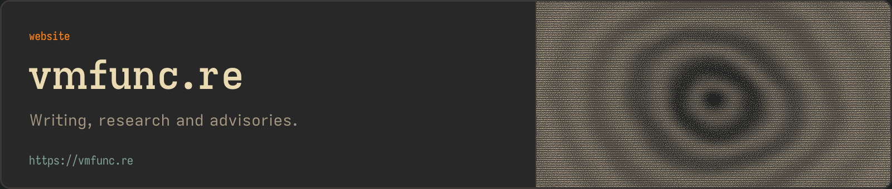
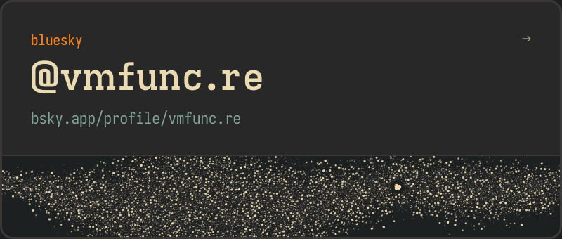
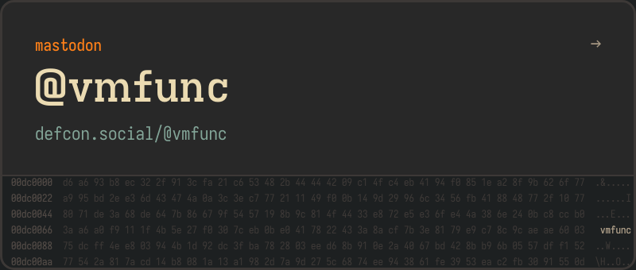
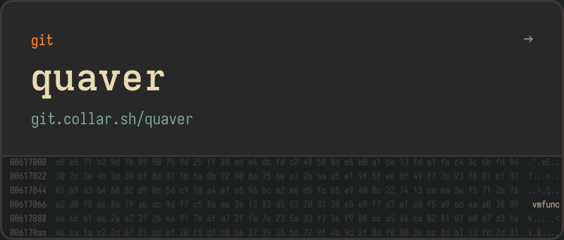

<a href="https://vmfunc.re"><picture><source media="(prefers-color-scheme: dark)" srcset="https://github.com/vmfunc/vmfunc/raw/main/assets/profile/header-dark.png"><source media="(prefers-color-scheme: light)" srcset="https://github.com/vmfunc/vmfunc/raw/main/assets/profile/header-light.png"></picture></a>

Previously at [Nous Research](https://github.com/nousresearch), Dash Crystal, Turing Pi and [Thales](https://github.com/thalesgroup). Now doing research and engineering at [Flock Capital](https://github.com/flockcap).

### Find me

<a href="https://vmfunc.re"><picture><source media="(prefers-color-scheme: dark)" srcset="https://github.com/vmfunc/vmfunc/raw/main/assets/profile/social-site-dark.png"><source media="(prefers-color-scheme: light)" srcset="https://github.com/vmfunc/vmfunc/raw/main/assets/profile/social-site-light.png"></picture></a>

<a href="https://x.com/vmfunc"><picture><source media="(prefers-color-scheme: dark)" srcset="https://github.com/vmfunc/vmfunc/raw/main/assets/profile/social-x-dark.png"><source media="(prefers-color-scheme: light)" srcset="https://github.com/vmfunc/vmfunc/raw/main/assets/profile/social-x-light.png"></picture></a>&nbsp;<a href="https://bsky.app/profile/vmfunc.re"><picture><source media="(prefers-color-scheme: dark)" srcset="https://github.com/vmfunc/vmfunc/raw/main/assets/profile/social-bsky-dark.png"><source media="(prefers-color-scheme: light)" srcset="https://github.com/vmfunc/vmfunc/raw/main/assets/profile/social-bsky-light.png"></picture></a>

<a rel="me" href="https://defcon.social/@vmfunc"><picture><source media="(prefers-color-scheme: dark)" srcset="https://github.com/vmfunc/vmfunc/raw/main/assets/profile/social-masto-dark.png"><source media="(prefers-color-scheme: light)" srcset="https://github.com/vmfunc/vmfunc/raw/main/assets/profile/social-masto-light.png"></picture></a>&nbsp;<a href="https://git.collar.sh/quaver"><picture><source media="(prefers-color-scheme: dark)" srcset="https://github.com/vmfunc/vmfunc/raw/main/assets/profile/social-git-dark.png"><source media="(prefers-color-scheme: light)" srcset="https://github.com/vmfunc/vmfunc/raw/main/assets/profile/social-git-light.png"></picture></a>

<picture><source media="(prefers-color-scheme: dark)" srcset="https://github.com/vmfunc/vmfunc/raw/main/assets/profile/footer-dark.png"><source media="(prefers-color-scheme: light)" srcset="https://github.com/vmfunc/vmfunc/raw/main/assets/profile/footer-light.png"></picture>

  

